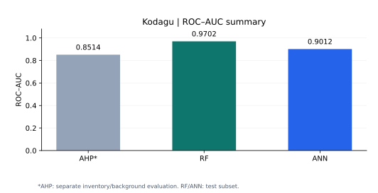
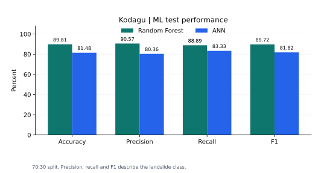
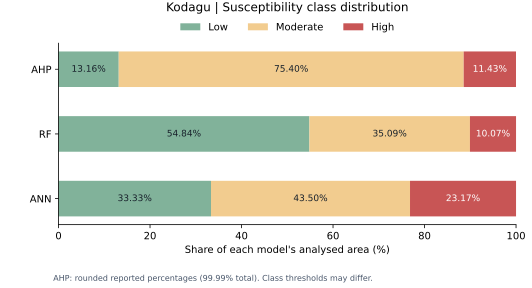
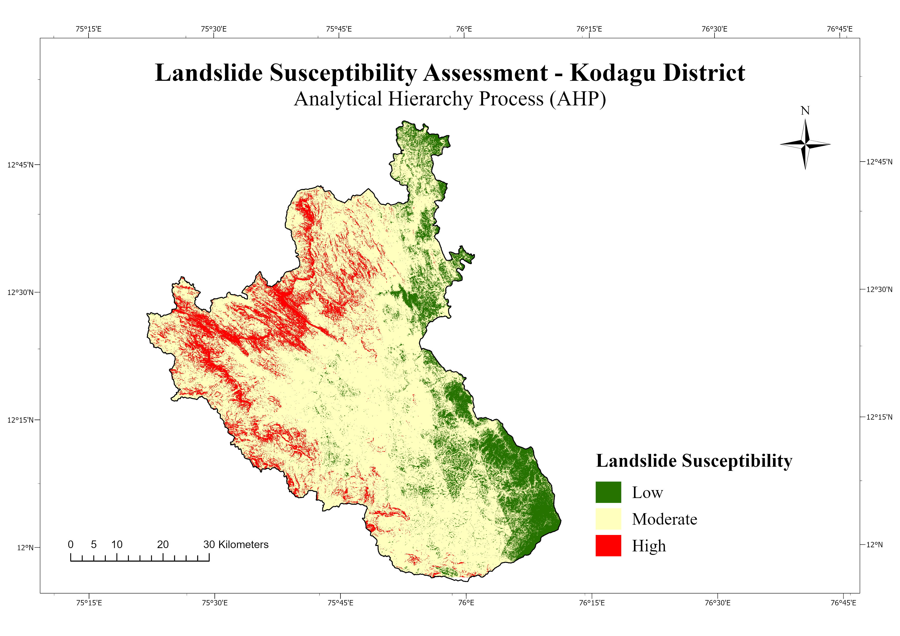
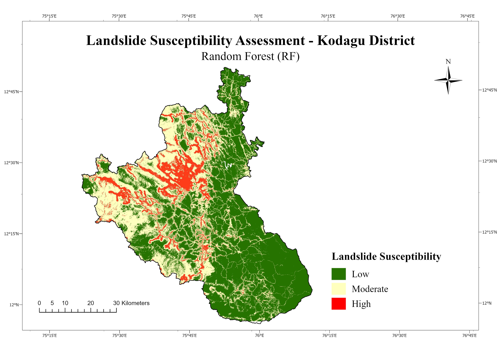
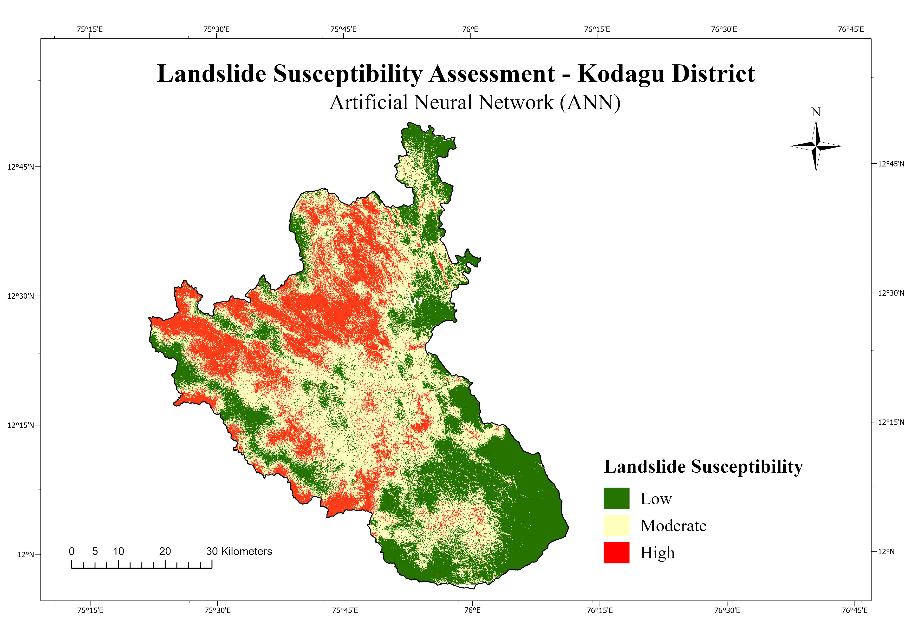
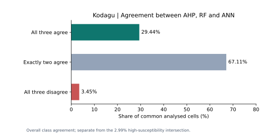
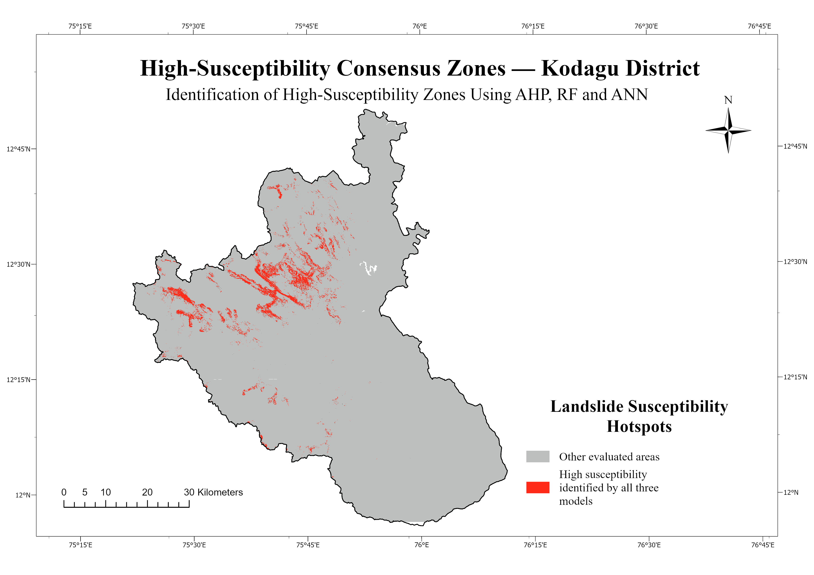

# Results: Kodagu Landslide Susceptibility

This folder contains comparison charts, machine-readable tables, and a detailed interpretation of the AHP, Random Forest (RF), and Artificial Neural Network (ANN) outputs.

**RF achieved the higher held-out performance of the two ML models:** ROC–AUC 0.9702 and accuracy 89.81%. Approximately **122 km²** was classified as high susceptibility by all three approaches.

## Model Performance

| Model | ROC–AUC | Accuracy | Precision¹ | Recall¹ | F1¹ |
| --- | ---: | ---: | ---: | ---: | ---: |
| AHP | 0.8514 | — | — | — | — |
| Random Forest | 0.9702 | 89.81% | 90.57% | 88.89% | 89.72% |
| ANN | 0.9012 | 81.48% | 80.36% | 83.33% | 81.82% |

¹ Precision, recall and F1 refer to the landslide class (1). Missing AHP threshold-based metrics were not reconstructed.

AHP was evaluated using a continuous susceptibility index at 181 landslide and 179 background locations. RF and ANN scores refer to the test subset from a 70:30 split. Their evaluation designs differ, so the AHP score is shown separately in interpretation. AUC is a discrimination metric, not accuracy.

RF exceeded ANN by **8.33 percentage points in accuracy** and **0.0690 in ROC–AUC**. These differences describe this experiment; repeated or spatially separated validation would be needed to assess their stability.

## Confusion Matrices

Rows represent actual classes and columns predicted classes. Class 0 is background; class 1 is landslide.

| Model | True negative | False positive | False negative | True positive |
| --- | ---: | ---: | ---: | ---: |
| RF | 49 | 5 | 6 | 48 |
| ANN | 43 | 11 | 9 | 45 |

Each matrix contains **108 test samples**, with 54 samples in each actual class. RF correctly classified 97; ANN correctly classified 88. RF missed 6 landslide samples compared with 9 for ANN, and produced 5 false positives compared with 11 for ANN.

These matrices describe sampled locations. They do not mean that a corresponding percentage of all mapped pixels has been independently validated.

## Susceptibility Class Distribution

| Model | Low | Moderate | High |
| --- | ---: | ---: | ---: |
| AHP | 13.16% | 75.40% | 11.43% |
| RF | 54.84% | 35.09% | 10.07% |
| ANN | 33.33% | 43.50% | 23.17% |

AHP percentages were recovered as rounded values and sum to 99.99%. Exact final AHP cell counts were not recovered. RF and ANN percentages above are rounded for display; their more precise reported values and counts are in [the class-area table](susceptibility_area_statistics.csv).

### AHP Map

The AHP map is dominated by the **moderate class (75.40%)**, with smaller low (13.16%) and high (11.43%) zones. This distribution indicates that the selected weights and factor scores place most analysed terrain in the middle susceptibility category.

The result reflects the chosen pairwise weights and reclassification rules. Broad moderate coverage alone does not demonstrate weak or strong predictive performance. The continuous LSI yielded ROC–AUC **0.8514** in the separate inventory/background evaluation.

### Random Forest Map

RF assigns **2,388,517 cells to low**, **1,528,433 to moderate**, and **438,785 to high** susceptibility. Low susceptibility occupies 54.84% of the analysed raster footprint, while high susceptibility occupies 10.07%.

RF produces the smallest high-class proportion among the three reported maps. Its higher sample-level test metrics support its discrimination in this experiment, but the smaller high-class footprint is also affected by classification thresholds. It should not be taken as evidence that every cell outside the high class is stable.

### ANN Map

ANN assigns **1,451,630 cells to low**, **1,894,681 to moderate**, and **1,009,424 to high** susceptibility. The moderate class is largest at 43.50%; high susceptibility covers 23.17%.

ANN labels a larger share as high than RF: a difference of approximately **13.10 percentage points**, or **570,639 cells**, across their equal-sized reported footprints. The ANN high-class area is about **2.30 times** the RF high-class area. This measures classified spatial extent, not a ratio of actual landslide probabilities.

The difference may reflect model behaviour and class boundaries. Feature effects cannot be established from these class totals alone.

## Agreement Between Maps

| Agreement | Cells | Share |
| --- | ---: | ---: |
| All three assign the same class | 1,282,509 | 29.44% |
| Exactly two assign the same class | 2,923,045 | 67.11% |
| All three assign different classes | 150,127 | 3.45% |

Exactly two models agree across most of the common analysed footprint. At least two agree in **96.55%** of cells, but unanimity occurs in only **29.44%**. With three possible classes and three models, “all disagree” means one assigns low, another moderate, and the third high.

This overall agreement is different from high-susceptibility consensus: unanimous agreement also includes unanimously low and moderate cells. It is not a validation accuracy score.

### High-Susceptibility Consensus

The intersection of all three high classes contains **130,022 cells**, covering approximately **122 km²**, or **2.99%** of the analysed agreement footprint. These locations are a useful set of consistently highlighted areas for further investigation.

Consensus does not remove shared input-data errors or sampling effects. Locations outside the intersection may still be susceptible according to one or two methods. No village-level or administrative hotspot claims are made here because those zonal results were not available.

## Interpretation and Practical Meaning

The comparison has two separate outcomes:

- **Sample-level discrimination:** RF performed better than ANN on the reported test set.
- **Spatial classification:** model maps differ substantially in the amount of terrain assigned to each class; the three-model high intersection is much smaller than any individual high class.

The high-consensus output helps focus further review, while individual model maps retain areas where methods disagree. Susceptibility maps describe relative spatial tendency; they do not predict event timing or quantify exposure, vulnerability, or risk.

## Data Consistency and Limits

- RF and ANN class tables each total **4,355,735 cells**. The agreement categories total **4,355,681 cells**, a difference of **54 cells**. Separate denominators are retained. The original rasters are needed to establish whether differing valid-data masks caused the discrepancy.
- Exact final AHP counts, class thresholds, complete model settings, and per-class area in km² were not recovered. No such values were inferred from preliminary overlays or rounded percentages.
- The approximate 122 km² consensus area is retained as originally reported. Other class areas in km² have not been derived without confirmed final raster metadata.
- A preliminary sample dataset contained 362 records, while the recovered confusion matrices contain 108 test records. The final cleaning and split records are needed to reconcile these totals.
- Background sampling excluded a 500 m buffer around known landslides, excluded water bodies, and selected low-to-moderate slopes. This can make discrimination easier and affect generalisation.
- Spatial dependence can remain under a random train/test split. Spatial validation and an independent inventory would strengthen the conclusions.
- AHP and ML use different evaluation setups. No combined leaderboard or statistical significance claim is made.
- AUC values alone cannot reconstruct ROC curves. No synthetic ROC curves or invented feature-importance plots are included.

## Files and Provenance

The values were recovered from the **“Land Slide project”** conversation, including user-provided class/agreement tables and prior evaluation summaries. They have been transcribed and checked for arithmetic consistency; the models were not retrained for this results package. Metric summaries should be cross-checked against the original saved notebooks when those are uploaded.

| File | Contents |
| --- | --- |
| [model_performance.csv](model_performance.csv) | AUC and reported ML classification metrics |
| [confusion_matrices.csv](confusion_matrices.csv) | Actual versus predicted class counts |
| [susceptibility_area_statistics.csv](susceptibility_area_statistics.csv) | Class counts and percentages; missing AHP counts left blank |
| [model_agreement_statistics.csv](model_agreement_statistics.csv) | Three categories of spatial agreement |
| [high_susceptibility_agreement.csv](high_susceptibility_agreement.csv) | High-consensus count, approximate area and percentage |
| [charts/](charts/) | Four compact comparison charts |
| [generate_charts.py](generate_charts.py) | Recreates the charts from these CSV tables |

To regenerate the charts, install Matplotlib and run `python Results/generate_charts.py` from the repository root.
